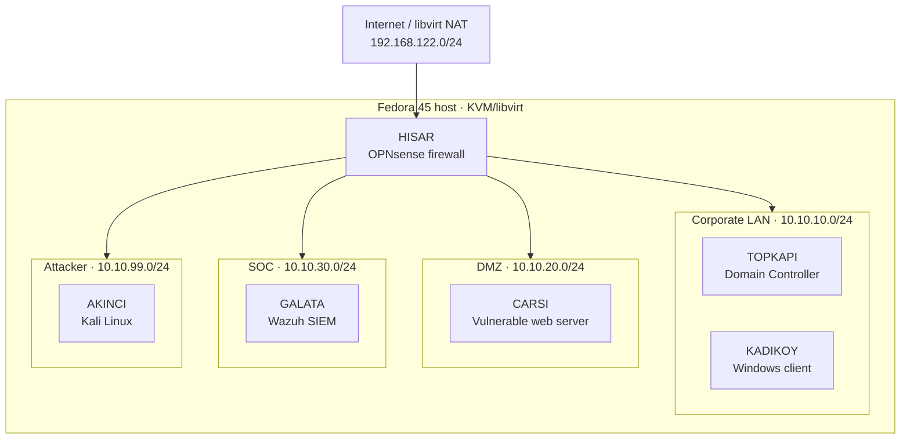

# Bosphorus: Purple Team Homelab


A virtualized enterprise network built to practice both sides of security: **attacking** an Active Directory environment and **detecting** those attacks with a SIEM. Every scenario is documented end-to-end: attack, detection, mitigation, and MITRE ATT&CK mapping.

The project is named after the Bosphorus in Istanbul, and every machine is named after a landmark that reflects its role.

---

## Table of Contents

- [Goals](#goals)
- [Architecture](#architecture)
- [Network Plan](#network-plan)
- [Machines](#machines)
- [Tech Stack](#tech-stack)
- [Scenarios](#scenarios)
- [Roadmap](#roadmap)
- [Repository Structure](#repository-structure)
- [Lessons Learned](#lessons-learned)
- [Disclaimer](#disclaimer)
- [License](#license)

---

## Goals

- Simulate a realistic small-company network with segmentation (LAN, DMZ, SOC, attacker zone)
- Practice **Red Team** techniques against Active Directory and exposed web services
- Build **Blue Team** detections in Wazuh using Sysmon and Windows event logs
- Write mitigations from a **risk and governance** perspective
- Keep everything reproducible and documented as a learning record

---

## Architecture



> An editable diagram is in [`diagrams/`](diagrams/).

---

## Network Plan

| Segment | libvirt network | Bridge | Subnet | Gateway | Purpose |
|---|---|---|---|---|---|
| WAN | `default` | `virbr0` | 192.168.122.0/24 | 192.168.122.1 | Internet access (NAT) |
| Corporate LAN | `lab-lan` | `virbr10` | 10.10.10.0/24 | 10.10.10.1 | Active Directory and users |
| DMZ | `lab-dmz` | `virbr20` | 10.10.20.0/24 | 10.10.20.1 | Public-facing services |
| SOC | `lab-soc` | `virbr30` | 10.10.30.0/24 | 10.10.30.1 | Monitoring and SIEM |
| Attacker | `lab-red` | `virbr99` | 10.10.99.0/24 | 10.10.99.1 | Offensive tooling |

All lab networks are **isolated** in libvirt (no forwarding, no host IP). Routing, DHCP and filtering are handled only by the firewall.

**Active Directory domain:** `corp.bosphorus.lab` (NetBIOS: `BOSPHORUS`)

---

## Machines

| Hostname | Role | OS | IP | RAM | Named after |
|---|---|---|---|---|---|
| `HISAR` | Firewall / router | OPNsense | .1 on each segment | 1 GB | The fortresses that guarded the Bosphorus |
| `TOPKAPI` | Domain Controller, DNS | Windows Server 2022 | 10.10.10.10 | 2–3 GB | Seat of administration |
| `KADIKOY` | Domain workstation | Windows 11 | 10.10.10.50 | 2–3 GB | An everyday neighborhood |
| `CARSI` | Vulnerable web app | Linux | 10.10.20.10 | 1 GB | The Grand Bazaar, open to everyone |
| `GALATA` | SIEM | Wazuh (all-in-one) | 10.10.30.10 | 4 GB | The watchtower that saw the whole city |
| `AKINCI` | Attacker | Kali Linux | 10.10.99.10 | 2 GB | Raiders |

**Host:** Intel Core i5-12500H · 16 GB RAM · 480 GB SSD · Fedora 45

Because RAM is limited, the lab runs as **scenario profiles** rather than all at once:

| Profile | Running VMs |
|---|---|
| Red Team | HISAR, TOPKAPI, KADIKOY, AKINCI |
| Blue Team | HISAR, TOPKAPI, KADIKOY, GALATA |
| Web / DMZ | HISAR, CARSI, AKINCI |

---

## Tech Stack

| Area | Tools |
|---|---|
| Virtualization | KVM, QEMU, libvirt, virt-manager |
| Network & firewall | OPNsense |
| Identity | Windows Server Active Directory, Group Policy |
| Monitoring | Wazuh, Sysmon, Windows Event Logs |
| Offensive | Kali Linux, Impacket, BloodHound, Nmap, Burp Suite |
| Documentation | Markdown, Mermaid, draw.io |

---

## Scenarios

Each scenario follows the same structure: **Objective → Attack → Detection → Mitigation → MITRE ATT&CK → Lessons Learned**.

| # | Scenario | MITRE ATT&CK | Status |
|---|---|---|---|
| 01 | Network reconnaissance from the attacker zone | T1046 | 🔜 Planned |
| 02 | Password spraying against AD | T1110.003 | 🔜 Planned |
| 03 | Kerberoasting | T1558.003 | 🔜 Planned |
| 04 | AS-REP Roasting | T1558.004 | 🔜 Planned |
| 05 | AD enumeration with BloodHound | T1087.002 | 🔜 Planned |
| 06 | Web exploitation in the DMZ | T1190 | 🔜 Planned |
| 07 | Firewall rule bypass / segmentation testing | T1599 | 🔜 Planned |

Status legend: ✅ Done · 🚧 In progress · 🔜 Planned

---

## Roadmap

- [ ] **Phase 1 – Infrastructure:** KVM host, isolated networks, OPNsense with segment rules
- [ ] **Phase 2 – Identity:** Domain Controller, Windows client, users, groups, GPOs
- [ ] **Phase 3 – Attack surface:** Kali, vulnerable web server in the DMZ
- [ ] **Phase 4 – SOC:** Wazuh, Sysmon and agents on Windows hosts, custom rules
- [ ] **Phase 5 – Scenarios:** Execute and document attack/detection pairs
- [ ] **Phase 6 – Physical extension:** Second host for honeypot, syslog and monitoring

---

## Repository Structure

```
bosphorus-purple-team-lab/
├── README.md
├── docs/
│   ├── 00-architecture.md
│   ├── 01-host-setup.md
│   ├── 02-firewall.md
│   ├── 03-active-directory.md
│   └── 04-wazuh-soc.md
├── configs/
│   ├── libvirt-networks/
│   ├── firewall/
│   └── sysmon/
├── scenarios/
│   └── 01-recon/
├── diagrams/
└── screenshots/
```

---

## Lessons Learned

Problems I hit while building the lab and how I solved them. Updated as the project grows.

| Problem | Cause | Fix |
|---|---|---|
| _Coming soon_ | | |

---

## Disclaimer

This lab is an isolated environment built for education. All attacks are performed only against machines I own, inside networks with no route to external systems. Do not use these techniques against systems you do not have explicit permission to test.

---

## License

This project is licensed under the [MIT License](LICENSE).
Third-party configurations keep their original licenses and are credited where used.
